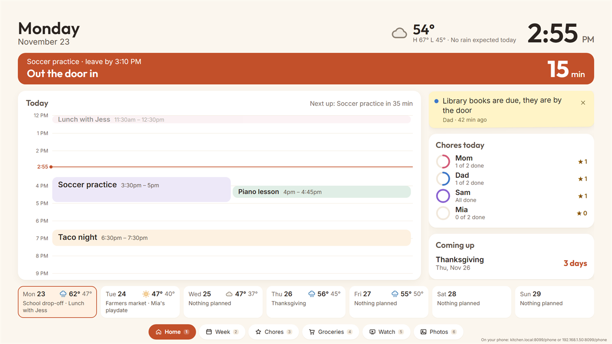
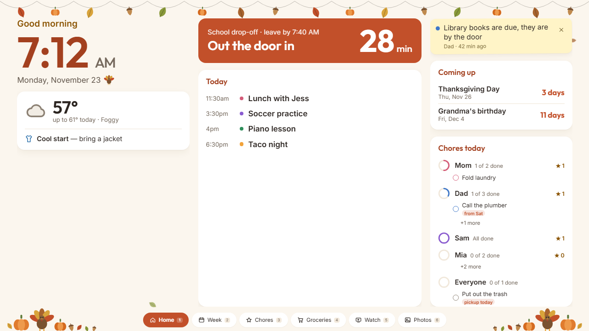
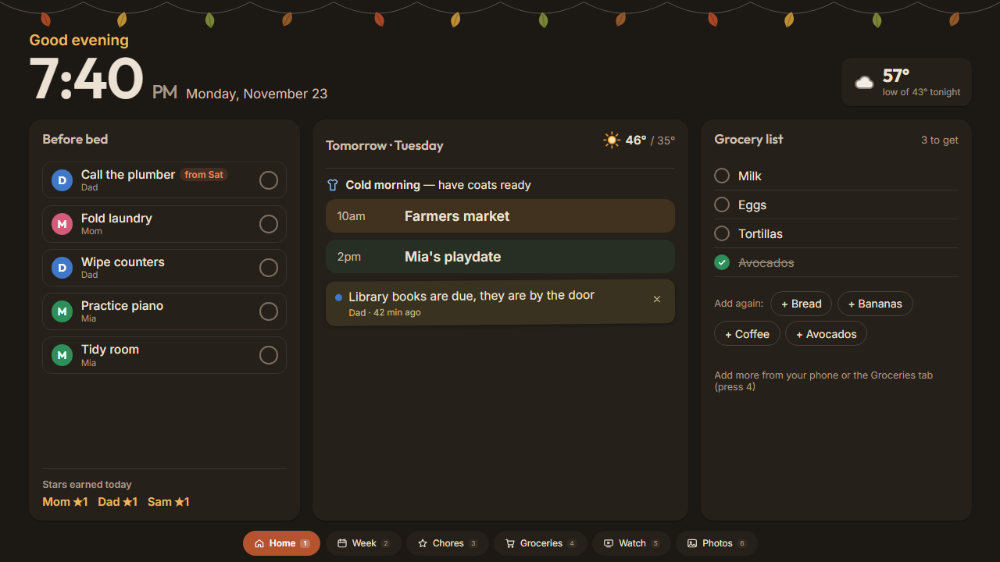
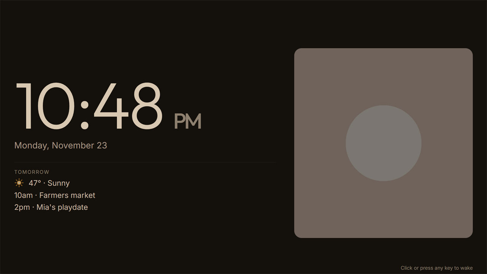
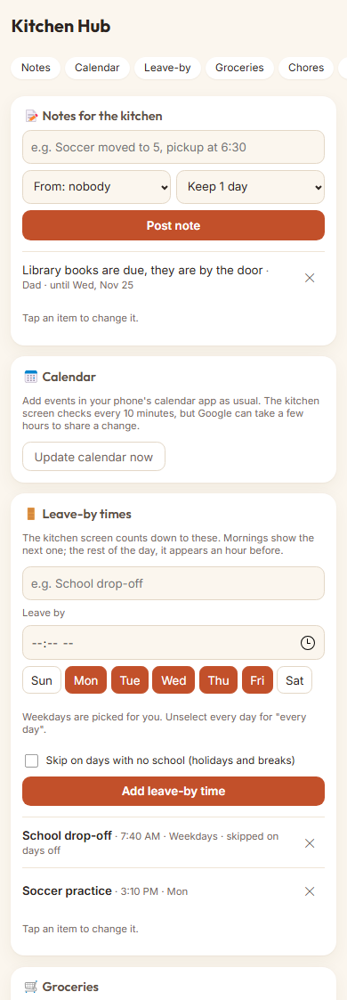

# Kitchen Hub

A family calendar, chore chart, grocery list, notes board and photo frame for a screen in your kitchen — plus one-click buttons for your streaming services. It runs on any Windows PC, everyone edits it from their phone, and everything stays on your home network.



## What it does

- **Changes with the time of day.** Mornings show a big clock, weather tips ("Cool start — bring a jacket") and a countdown to when you need to leave. Daytime shows today as a timeline. Evenings show chores left before bed, tomorrow's plan and the grocery list. Late at night it dims to a quiet clock, and after midnight it turns the monitor off.
- **Calendar.** Reads your Google or iCloud calendars (and US holidays). Click an event for its time, place and notes. Events titled `Sam: Soccer` show in Sam's color.
- **Chores.** Daily, weekly or one-time chores per person, with progress rings and weekly stars.
- **Groceries.** A shared list with one-click "Add again" buttons for things you buy often.
- **Notes.** Post a note from your phone ("Dentist forms are on the counter"); it shows on the kitchen screen for a day, three days or a week.
- **Countdowns.** "Thanksgiving in 3 days", birthdays that repeat every year. Big holidays (Thanksgiving, Christmas, Halloween…) count down automatically from your holiday calendar.
- **Weather.** Current conditions, a 7-day forecast, rain timing, air quality, UV, sunset — and National Weather Service alerts (US) as a banner that stays on screen.
- **Photo frame.** Upload photos from your phone; when nobody's using the screen it shows them as a slideshow, pairing portrait photos side by side.
- **Watch.** Big buttons that open Netflix, YouTube, Disney+ and others in Edge.
- **Easy on the eyes.** Warm, dark colors from sunset to sunrise.

| Morning | Evening (after sunset) |
| --- | --- |
|  |  |
| **Late night** | **Phone page** |
|  |  |

## What you need

- A Windows 10 or 11 PC connected to a screen. An old laptop or mini PC is fine.
- A way to use it: a touchscreen, or a wireless keyboard with a touchpad (everything works with either).
- A Google or iCloud calendar (optional, but it's the heart of the screen).
- Phones on the same home Wi-Fi for editing.

The setup script installs everything else (Node.js).

## Setting up the kitchen PC

1. **Download** this repository (green **Code** button → **Download ZIP**) and unzip it somewhere permanent, e.g. `C:\KitchenHub`.
2. **Run setup.** Open PowerShell **as administrator** (Start → type `powershell` → **Run as administrator**), then:
   ```powershell
   cd C:\KitchenHub
   powershell -ExecutionPolicy Bypass -File scripts\setup.ps1
   ```
   This installs Node.js if needed, lets phones on your home network connect, keeps the PC from sleeping, stops Edge from ignoring full-screen mode, and starts Kitchen Hub every time you sign in.
3. **Edit `config.json`** (created by setup) with your family's names, calendar links and location — see [Configuration](#configuration).
4. **Optional — automatic sign-in**, so the screen comes back by itself after a restart or power cut: press Win+R, run `netplwiz`, untick *Users must enter a user name and password to use this computer*. If that box is missing, first turn off *Settings → Accounts → Sign-in options → "For improved security, only allow Windows Hello sign-in"*.
5. **Sign in to your streaming services** once in Edge.
6. **Restart.** Kitchen Hub opens full screen when you sign in.

### On your phone

On the home Wi-Fi, open `http://<pc-name>.local:8080/phone` — for a PC named `kitchen`, that's `http://kitchen.local:8080/phone`. The exact address is in the bottom-right corner of the kitchen screen. Then use **Share → Add to Home Screen** for an app icon.

If the `.local` address doesn't open (some Android phones don't support it), use the IP address shown next to it instead, and reserve that address for the PC in your router so it doesn't change.

### Using it away from home

Kitchen Hub has no password, so **don't forward its port on your router**: anyone who found the address could read your calendar and post notes. Use [Tailscale](https://tailscale.com) instead (free for personal use). It links your phones and the kitchen PC into a private network that only your own devices can join.

1. On the kitchen PC, install Tailscale (`winget install Tailscale.Tailscale`) and sign in.
2. On each phone, install the Tailscale app and sign in with the same account.
3. With Tailscale on, open `http://<pc-name>:8080/phone` from anywhere, e.g. `http://kitchen:8080/phone`. If the name doesn't load, use the PC's `100.x.x.x` address from the Tailscale app.

Two tips:
- In the Tailscale admin console, choose **Disable key expiry** for the kitchen PC, or it gets signed out after about six months.
- Run `tailscale up --unattended` once on the PC so it stays connected even before anyone signs in to Windows.

Windows normally treats Tailscale as a private network, so the firewall rule from `setup.ps1` already lets it through. If phones can't connect, check that the Tailscale network is set to Private in Windows settings.

## Configuration

Settings live in `config.json` in the Kitchen Hub folder ([`config.example.json`](config.example.json) shows every option). Restart the PC, or the server, after changing it.

| Setting | What it does |
| --- | --- |
| `people` | Family members and their colors, used for chores, notes and event colors. |
| `calendars` | One entry per calendar: a name, a color and its iCal link (see below). |
| `calendarRefreshMinutes` | How often calendars are re-read (default 10). |
| `weather` | Your `latitude` and `longitude` (look your town up on latlong.net) and `fahrenheit` or `celsius`. |
| `photoFrameAfterMinutes` | After this many idle minutes the screen returns to Home, and during the day starts the slideshow. `0` turns the slideshow off. |
| `slideSeconds` | How long each slideshow photo stays up (default 8; collages get 3 more). |
| `screenOffAt` | When the monitor turns off for the night once nobody's using it (default `"0:00"`, midnight; `false` keeps it on). Any key or touch wakes it, and it turns back on when morning starts. |
| `showCountdownsWithinDays` | Show a countdown on the kitchen screen once it's this many days away (default 60). The phone page always lists them all. |
| `holidayCountdowns` | Calendar events that get a countdown automatically, by exact title. Defaults to New Year's Day, Valentine's Day, Easter Sunday, Mother's Day, Memorial Day, Father's Day, Independence Day, Labor Day, Halloween, Thanksgiving Day and Christmas Day (as named in Google's US holidays calendar). Give your own list, or `false` for none. |
| `modes` | When each Home screen starts: `{"morning": "6:00", "weekendMorning": "8:00", "day": "10:00", "evening": "17:00", "night": "22:00"}` (the defaults). |
| `services` | The buttons on the Watch tab. Add, remove or reorder freely. |
| `port` | The web server's port (default 8080). |

### Calendar links

Kitchen Hub reads calendars through their private iCal links.

- **Google:** on a computer, open calendar.google.com → ⚙ Settings → click the calendar on the left → *Integrate calendar* → copy **Secret address in iCal format**. Repeat for each calendar you want.
- **iCloud:** on an iPhone, Calendar → Calendars → ⓘ next to the calendar → turn on **Public Calendar** → Share Link.
- **US holidays:** Google's holiday calendar isn't part of your own calendar's link; add it as its own entry:
  ```json
  { "name": "Holidays", "color": "#857a6e", "url": "https://calendar.google.com/calendar/ical/en.usa%23holiday%40group.v.calendar.google.com/public/basic.ics" }
  ```

Treat private calendar links like passwords: anyone who has one can read that calendar. `config.json` is never committed to git.

**Colors per person:** start an event's title with a name from `people` — `Sam: Soccer` or `Sam - Soccer` shows as "Soccer" in Sam's color; `Sam's recital` keeps its title and gets Sam's color.

## Everyday use

### Home through the day

| Time | Home shows |
| --- | --- |
| **Morning** (6–10 AM; 8–10 on weekends) | Big clock, weather tips, the leave-by countdown, today's plan, notes and chores. |
| **Day** (10 AM–5 PM) | Today as a timeline with a "now" line, the chores still left, notes, countdowns and the week ahead. The slideshow starts here when the screen is left alone. |

On quiet days (two or fewer events left on the calendar), mornings and daytime put a chore board in the big space instead: a column per person with every chore for today, checked off with a click. Today's few events move to a short list on the side.
| **Evening** (5–10 PM) | Chores left before bed, tomorrow's plan and weather, and the grocery list. |
| **Late night** (10 PM until morning) | A dim clock with tomorrow's first plans. After `screenOffAt` the monitor turns off. |

From sunset to sunrise every tab uses warm, dark colors. When the screen is left alone it returns to Home. To preview another time, add `?at=2026-11-23T07:12` to the kitchen screen's address.

### Keyboard

| Key | Does |
| --- | --- |
| `1`–`6` | Home, Week, Chores, Groceries, Watch, Photos |
| `H` or `Esc` | Back to Home |
| `G` | Jump to the grocery box |
| `N` (on Chores) | Start a new chore |
| `Ctrl+Z` | Undo the last check-off or removed note |
| Any key | Stop the slideshow, or wake the night screen |

The pointer hides itself when the touchpad isn't in use.

### The phone page

- **Notes** for the kitchen, from someone, kept for 1 day, 3 days or a week.
- **Leave-by times**, e.g. "School drop-off, 7:40, weekdays". Mornings count down to the next one; the rest of the day it appears an hour before.
- **Groceries**, **chores** (who, and which days — none means every day; or *just today*, *just tomorrow* or a date for a one-off), **countdowns** (tick "repeats every year" for birthdays) and **photos** (duplicates are skipped automatically).
- Tap any note, chore, countdown or leave-by time to change it.

### On the kitchen screen

- Check off chores and groceries with a click or tap; a few seconds of **Undo** appear in case of a slip.
- Add groceries and chores directly if the screen has a keyboard.
- **Watch** opens the service in a normal Edge window; close it (✕ or Alt+F4) to come back.

## Troubleshooting

- **Phone page won't load:** the phone must be on the same Wi-Fi. If the `.local` address doesn't work, use the IP address from the corner of the kitchen screen.
- **Not full screen:** press any key. Re-running `setup.ps1` as administrator turns off Edge's "startup boost", the usual cause.
- **A note in the bottom-left corner:** the calendar, weather or server stopped updating. It clears itself once things recover.
- **"Couldn't update the calendar":** the calendar link in `config.json` is wrong or was reset. Copy it again.
- **"Can't reach the Kitchen Hub server":** check `data\server-error.log`. The server restarts itself within a few seconds if it stops.
- **Slideshow flickers on an older PC:** update the graphics driver. Photos are already shrunk to screen size before they're shown.

## Privacy

Kitchen Hub has no accounts and no cloud service of its own. Your notes, chores, groceries and photos are stored in the `data` folder on the kitchen PC and never leave your home network (or your private Tailscale network, if you [use it away from home](#using-it-away-from-home)). To get its information, the PC contacts:

- your calendar providers (the links in `config.json`),
- [Open-Meteo](https://open-meteo.com) for weather and air quality, and the [National Weather Service](https://www.weather.gov) for alerts (both only receive your configured location),
- Google Fonts for the typefaces.

Back up the `data` folder to keep your lists and photos.

## For developers

Requires [Node.js](https://nodejs.org) 18 or newer.

```bash
npm install
cp config.example.json config.json   # then edit it
npm start                            # http://localhost:8080 and /phone
```

| Path | What it is |
| --- | --- |
| `server.js` | Express server: state (`data/state.json`), calendar fetching and parsing, weather alerts, photo uploads, and the JSON API. |
| `public/index.html`, `public/app.js` | The kitchen screen: time-of-day Home screens, tabs, slideshow, keyboard handling. |
| `public/phone.html`, `public/phone.js` | The phone editor. |
| `public/shared.js` | Helpers used by both pages (DOM builder, countdowns, alert banners). |
| `public/style.css` | All styles; colors are CSS variables, swapped for the dusk theme. |
| `scripts/setup.ps1` | One-time Windows setup (run as administrator). |
| `scripts/start-kiosk.ps1` | Runs at sign-in: keeps the server running and opens Edge full screen. |

The screens poll `/api/version` every few seconds and reload `/api/state` when it changes. Changes go through small JSON endpoints (`POST`/`PUT`/`DELETE` on `/api/chores`, `/api/notes`, `/api/countdowns`, `/api/departures`, `/api/grocery`). Add `?at=<date-time>` to the kitchen screen's URL to preview any time of day; previews never turn the monitor off.

## License

[MIT](LICENSE): free to use, change and share, including for your own family's kitchen.
